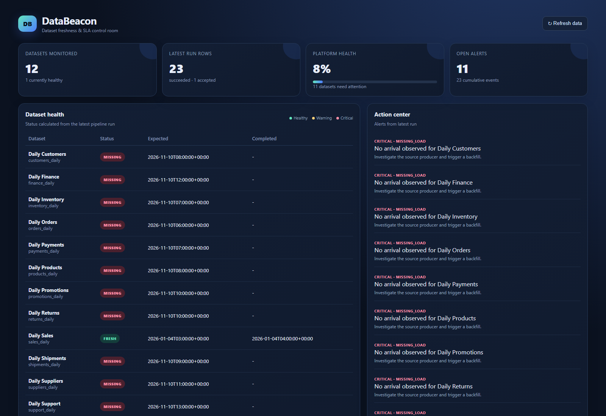

# DataBeacon

DataBeacon is a local, reproducible data-engineering vertical slice for
tracking expected dataset arrivals, completion SLAs, freshness, missing/late
loads, rejects, and actionable alerts.

The dashboard, data contract, and run scenarios are explained in the sections
below and in the linked architecture, data dictionary, and evaluation documents.

## Architecture

`CSV producer -> ingestion/validation -> SQLite target + quarantine -> SLA rules
-> alerts/reports -> FastAPI dashboard/API`

The source grain is one arrival event per `(dataset_id, expected_at)`. Stable
event keys are SHA-256 hashes of that pair. `run_id` and `source_file` are
retained on runs, accepted events, and rejects. SQLite constraints enforce
dataset references and one published event per event key.

## Run locally

```powershell
py -m venv .venv
.\.venv\Scripts\python -m pip install -e ".[test]"
.\.venv\Scripts\python -m databeacon generate
.\.venv\Scripts\python -m databeacon run
.\.venv\Scripts\python -m databeacon report
.\.venv\Scripts\python -m databeacon reconcile
.\.venv\Scripts\python scripts\run_tests.py
.\.venv\Scripts\python -m uvicorn databeacon.api.app:app --reload
```

For a larger synthetic run, use `python scripts/benchmark.py --rows 100000`.
A measured local run processed 100,000 rows in about 6.76 seconds (~14,796
rows/second); results depend on the machine. The pipeline uses a single SQLite
session, parameterized writes, conflict-safe event keys, and monitoring
indexes.

Open `http://127.0.0.1:8000/`. API endpoints include `/api/health`, `/api/dashboard`, `/api/report`,
`/api/rejects`, `/api/alerts`, `POST /api/alerts/{id}/acknowledge`, and
`POST /api/runs?source_file=...`. The dashboard supports responsive layouts,
status pills, alert actions, reconciliation summary, and refresh without a
frontend build step. It automatically refreshes every five seconds.

## Dashboard guide

The screenshots below show the current dashboard layout. They are documentation
screenshots only; they do not imply any dashboard style changes.

### Dashboard overview



* **Datasets monitored** — number of active dataset definitions in SQLite.
  This is the configured catalog count, not the number of input rows in one run.
* **Latest run rows** — records read from the most recent pipeline input,
  including accepted, rejected, and duplicate records.
* **Platform health** — current fresh datasets divided by monitored datasets;
  the supporting text shows datasets needing attention.
* **Open alerts** — unacknowledged alerts for the latest run. Older alerts
  remain available in the alert API and persisted in SQLite.
* **Dataset health** — latest run's per-dataset status, expected arrival and
  completion timestamps. Statuses distinguish fresh, late, incomplete, missing,
  and scheduled datasets.
* **Action center** — actionable warnings and critical alerts associated with
  the latest run. Acknowledge an alert to remove it from the open-alert view;
  its stored record remains in the database.
* **Pipeline run history** — expandable run records ordered newest first.
  Expand any run to view that run's dataset health, including datasets that did
  not arrive in that run. Open run panels remain open as the dashboard refreshes.
* **Data quality pulse** — latest-run details and aggregate event, status,
  reject, and alert counts for operational reconciliation.
* **Refresh data** — reloads the database-backed dashboard immediately; normal
  automatic refresh runs every five seconds.

### Run history and dataset health


The run history includes every persisted run, not only the most recent 20.
Each run header shows its start time, status, input rows, and accepted rows.
Expanding it displays the active dataset catalog with the status determined
from events published by that run. If a dataset was not present in the run, it
is shown as missing for that run. A rerun skipped due to an identical input is
not stored as a new run; successful, partial, and failed run records remain in
the database.

## Operational behavior

* Row-level invalid records are quarantined with source row and raw payload.
  Fatal schema changes fail the run explicitly.
* A SHA-256 input fingerprint makes successful/partial reruns safe; rerunning
  the same file returns `skipped` and does not publish duplicates.
* A failed run remains in `runs` with its failure reason. Retry with a corrected
  or newly fingerprinted source file. Backfills use a new expected timestamp or
  explicitly prepared source file.
* `fresh` means completion is within the configured SLA, `late` exceeds it,
  `missing` has passed its expected time without arrival, and `incomplete`
  lacks completion.

## Data quality and evidence

`data/output/validation_report.json` contains run counts, status distribution,
published events, rejects, and alerts. The test suite verifies happy path,
empty/invalid values, malformed schema, duplicate keys, invalid references,
out-of-order records, and idempotent reruns. The generator function supports a
fixed seed; the CLI uses a random seed unless `--seed` is supplied and appends
randomized batches by default. Use `--rows` and `--file` to control a generated
batch and its destination.

`python -m databeacon reconcile` emits executable reconciliation evidence:
`input_count = accepted_count + rejected_count + duplicate_count` and
`published_event_count = unique_event_key_count`. The deliberately invalid
fixture is [invalid_events.csv](data/sample/invalid_events.csv), with expected
labels kept separately in
[invalid_events.expected.json](data/sample/invalid_events.expected.json).
To demonstrate an operational attention state, run
`python -m databeacon run --file data/sample/attention_events.csv --db data/attention_demo.db`.
`DATABEACON_DB` controls which SQLite database the web app reads. For the
attention demo, start it with:

```powershell
$env:DATABEACON_DB = "data/attention_demo.db"
python -m uvicorn databeacon.api.app:app --reload
```

It creates a late sales load, an incomplete inventory load, and leaves customers
without an event so the dashboard can show a missing-load alert. Expected
statuses and operator actions are documented separately in
[attention_events.expected.json](data/sample/attention_events.expected.json).
Pipeline logs include timestamps, run ID, status, counts, source file, and
failure details on stdout.

### When do open alerts increase?

Open alerts increase when a new run detects an issue:

| Condition | Severity | Alert type |
|---|---|---|
| Completion exceeds the configured SLA | warning | `sla_breach` |
| Arrival exists but completion is absent | warning | `incomplete_load` |
| Expected window passes without arrival | critical | `missing_load` |

Alerts are stored with their run, dataset, event, message, action, and
timestamp. The dashboard shows alerts from the latest run. Identical reruns
are skipped and do not create duplicates; acknowledgement removes an alert
from the open view while preserving its database history.

To demonstrate one critical alert:

```powershell
python -m databeacon run `
  --file data\sample\critical_missing_events.csv `
  --db data\critical_demo.db
$env:DATABEACON_DB = "data\critical_demo.db"
python -m uvicorn databeacon.api.app:app --reload
```

The dashboard will show `customers_daily` as **missing**, with a critical
`missing_load` alert and a backfill action. Expected results are in
[critical_missing_events.expected.json](data/sample/critical_missing_events.expected.json).

### Single dashboard demo: fresh + late + critical

To see all important operational states together without changing the UI, run:

```powershell
python -m databeacon run `
  --file data\sample\dashboard_demo_events.csv `
  --db data\dashboard_demo.db
$env:DATABEACON_DB = "data\dashboard_demo.db"
python -m uvicorn databeacon.api.app:app --reload
```

The existing dashboard will show:

| Dataset | Dashboard state | Why |
|---|---|---|
| `sales_daily` | late / warning | Completion is 210 minutes after expected; SLA is 120 minutes |
| `inventory_daily` | fresh | Completion is 60 minutes after expected; SLA is 180 minutes |
| `customers_daily` | missing / critical | It is configured but intentionally absent from the latest input |

The dashboard monitors 12 configured datasets. This compact demo intentionally
loads only two representative datasets so the other configured datasets expose
missing-load behavior; the normal generator creates one event for all 12.

This demonstration changes only the input dataset and database selection; no
dashboard code or UI changes are required.

### Why a run can show `skipped`

The generator function is deterministic when an explicit seed is supplied,
while the CLI uses a random seed and append-only mode by default. When `run`
sees that the file's SHA-256 fingerprint already exists in a successful or
partial run, it returns `skipped` intentionally. This is the idempotency
guarantee: the same input is not published twice. To process a new run, append
a new batch with `generate`, use a different input file, or use a corrected/
backfill file.

### Pytest troubleshooting on Windows

Some Python installations contain a machine-level `py.py` that shadows
pytest's compatibility module. If `python -m pytest` fails with
`AttributeError: module 'py' has no attribute 'path'`, use the repository
runner instead:

```powershell
.\.venv\Scripts\python scripts\run_tests.py
```

The runner removes only the known machine-level shadowing path before importing
pytest. The `letters`, `vowels`, and `consonants` output is not produced by
DataBeacon and comes from an unrelated command or file.

The dashboard automatically polls `/api/dashboard` and `/api/report` every five
seconds, so completed/failed runs, new alerts, acknowledgements, and
reconciliation changes appear without a manual page refresh.

### Random append-only generation

Running `python -m databeacon generate` now appends a new batch to
`data/sample/events.csv` instead of overwriting it. Each batch uses new expected
windows and randomly assigns healthy, warning, or critical behavior. A critical
dataset is intentionally omitted so the dashboard creates a missing-load alert.
Run `python -m databeacon run` after each generation. The database accumulates
new run rows and published event totals; duplicate rows from the appended file
are counted explicitly and do not create duplicate target events.

For a reproducible randomized batch:

```powershell
python -m databeacon generate --rows 12 --seed 123
python -m databeacon run
```

Project review artifacts are available in
[evaluation_metrics.md](docs/evaluation_metrics.md),
[manifest.json](data/manifest.json),
[architecture.md](docs/architecture.md), and
[data-dictionary.md](docs/data-dictionary.md).
The complete requirement-by-requirement audit is in
[requirements-matrix.md](docs/requirements-matrix.md).
The folder/file ownership and business alignment guide is in
[project-map.md](docs/project-map.md).
The consolidated test-data, expected-output, observed-result, and
reconciliation bundle is [test_evidence.json](data/test_evidence.json).
Regenerate it with:

```powershell
python scripts/build_test_evidence.py
```

## Limitations and next steps

This local slice does not connect to a real object store, scheduler, email,
Slack, or distributed database. Production hardening would add connector
adapters, authentication, scheduled expectation materialization, alert
acknowledgement workflows, retention, and load/concurrency testing.
