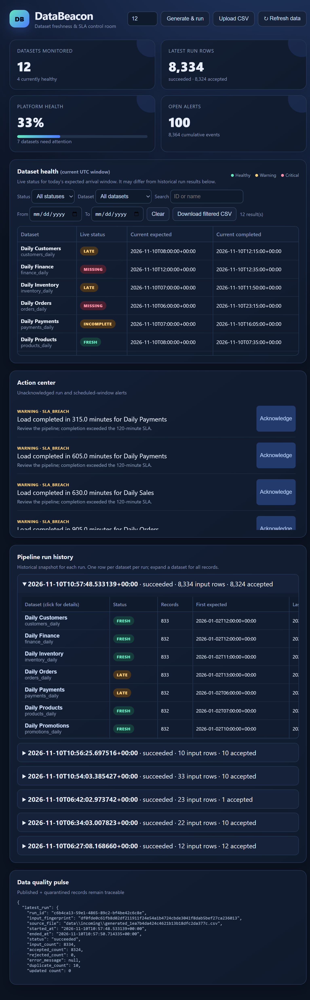
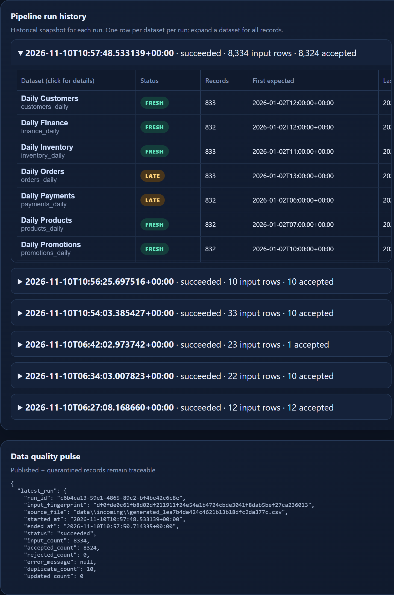

# DataBeacon

DataBeacon is a local, reproducible data-engineering vertical slice for
tracking expected dataset arrivals, completion SLAs, freshness, missing/late
loads, rejects, and actionable alerts.

The dashboard, data contract, and run scenarios are explained in the sections
below and in the linked architecture, data dictionary, and evaluation documents.

## Architecture

`CSV file or producer upload -> ingestion/validation -> SQLite target + quarantine
-> SLA rules + independent expected-window monitor -> alerts/reports -> FastAPI dashboard/API`

The source grain is one arrival event per `(dataset_id, expected_at)`. Stable
event keys are SHA-256 hashes of that pair. `run_id` and `source_file` are
retained on runs, accepted events, and rejects. SQLite constraints enforce
dataset references and one published event per event key.

## Run locally

```powershell
py -m venv .venv
.\.venv\Scripts\python -m pip install -e ".[test]"
.\.venv\Scripts\python -m databeacon generate
.\.venv\Scripts\python -m databeacon run
.\.venv\Scripts\python -m databeacon report
.\.venv\Scripts\python -m databeacon reconcile
.\.venv\Scripts\python scripts\run_tests.py
.\.venv\Scripts\python -m uvicorn databeacon.api.app:app --reload
```

For a larger synthetic run, use `python scripts/benchmark.py --rows 100000`.
A measured local run processed 100,000 rows in about 13.87 seconds (~7,210
rows/second); results depend on the machine. The pipeline uses a single SQLite
session, parameterized writes, conflict-safe event keys, append-only lifecycle
observations, and monitoring indexes.

Open `http://127.0.0.1:8000/`. API endpoints include `/api/health`,
`/api/dashboard`, `/api/report`, `/api/rejects`, `/api/alerts`,
`POST /api/alerts/{id}/acknowledge`, `POST /api/runs?source_file=...`,
`POST /api/runs/generate`, and `POST /api/runs/upload`. Downloadable CSV
outputs are available from `/api/download/events`, `/api/download/observations`,
`/api/download/rejects`, `/api/download/alerts`, and
`/api/download/windows`. The dashboard provides Generate & run, Upload CSV,
Refresh data, and Download data controls, and shows the current expected-window
status while auto-refreshing every five seconds. The dashboard uses compact
CSV-style tables with visible column separators and `S.No` columns in inline
accepted, rejected, and duplicate detail tables. Empty detail sections collapse
to their single no-records row instead of reserving a blank viewport.
The API also runs an independent deadline monitor (30-second default interval)
so missing/incomplete alerts are persisted even when no new CSV run occurs.

## Dashboard guide

The screenshots below show the current dashboard layout. They are documentation
screenshots only; they do not imply any dashboard style changes.

### Dashboard overview



* **Datasets monitored** — number of active dataset definitions in SQLite.
  This is the configured catalog count, not the number of input rows in one run.
* **Latest run rows** — records read from the most recent pipeline input,
  including accepted, rejected, and duplicate records.
* **Platform health** — currently fresh expected windows divided by monitored datasets;
  the supporting text shows datasets needing attention.
* **Open alerts** — unresolved, unacknowledged scheduled-window alerts plus
  alerts from the latest pipeline run. Acknowledged/resolved history remains
  available in SQLite and the alert API.
* **Dataset health** — status for the current UTC expected window, including
  its expected and completion timestamps. Run history retains the status at
  ingestion time.
* **Action center** — actionable warnings and critical alerts from the latest
  run and the independent window monitor. Acknowledge an open alert; its
  stored record remains in history.
* **Pipeline run history** — expandable run records ordered newest first,
  displayed full-width above the Data quality pulse. The history table has
  compact rows, visible column separators, and expandable dataset details.
  Expand any run to view that run's dataset health, including datasets that did
  not arrive in that run. Open run panels remain open during an explicit
  dashboard refresh.
* **Data quality pulse** — latest-run details and aggregate event, status,
  reject, and alert counts for operational reconciliation, kept below the
  full-width pipeline history.
* **Refresh data** — reloads the database-backed dashboard immediately; normal
  automatic refresh runs every five seconds.

### Run history and dataset health



The run history includes every persisted run, not only the most recent 20.
Each run header shows its start time, status, input rows, and accepted rows.
Expanding it displays the active dataset catalog with the status determined
from events published by that run. If a dataset was not present in the run, it
is shown as missing for that run. A rerun skipped due to an identical input is
not stored as a new run; successful, partial, and failed run records remain in
the database.

## Operational behavior

* Row-level invalid records are quarantined with source row and raw payload.
  Fatal schema changes fail the run explicitly.
* A SHA-256 input fingerprint makes successful/partial reruns safe; rerunning
  the same file returns `skipped` and does not publish duplicates.
* If a later producer file adds arrival/completion details for the same
  expected window, DataBeacon enriches the canonical event and records an
  append-only observation so each run's history remains accurate.
* A failed run remains in `runs` with its failure reason. Retry with a corrected
  or newly fingerprinted source file. Backfills use a new expected timestamp or
  explicitly prepared source file.
* Each active dataset receives a daily expected window at its configured UTC
  time. A load becomes `missing` after the configurable arrival grace period
  (15 minutes by default). An observed arrival becomes `incomplete` if it has
  not completed by its completion SLA; completed loads are `fresh` or `late`.
* The monitor runs in the API background worker and can also be run manually:
  `python -m databeacon monitor` or `POST /api/monitor/run`. It evaluates
  yesterday and today on restart, persists one alert per window/type, resolves
  missing/incomplete alerts when the load arrives/completes, and preserves
  acknowledged/resolved alert history.
* Browser polling refreshes the UI; the independent server-side monitor
  performs deadline evaluation. Configure `DATABEACON_MONITOR_INTERVAL_SECONDS`
  and `DATABEACON_ARRIVAL_GRACE_MINUTES` to change the monitor cadence/grace.
  When a pipeline-history dataset detail is open, browser polling is paused so
  the table does not flicker or refetch repeatedly. Use the explicit
  **Refresh data** button to refresh the dashboard while keeping the detail
  view selected.

### Provide producer data instead of generating it

The upload endpoint accepts the same normalized CSV contract shown in
[data-dictionary.md](docs/data-dictionary.md), validates it, stores the file
under `data/incoming/`, and runs the normal idempotent pipeline:

```powershell
Invoke-RestMethod -Uri http://127.0.0.1:8000/api/runs/upload `
  -Method Post -ContentType "text/csv" `
  -InFile "data\incoming\producer_events.csv"
```

The upload is limited to 25 MiB. The endpoint accepts CSV bytes, not a local
path supplied by a remote producer, and creates a safe server-side filename.
For producers with another schema, map fields to the documented contract in
their adapter before submitting. The current payload is arrival telemetry
(dataset ID, expected/arrival/completion timestamps, and row count); it does
not load the producer's underlying business rows into a warehouse.

The dashboard's **Generate & run** control uses the same pipeline as an uploaded
file. Its row-count field supports 0 through 1,000,000 rows, and the API also
accepts `seed` and `randomize_status` query parameters for reproducible or
deliberately mixed-health batches. After either input path completes, the
download controls expose the persisted canonical events, lifecycle
observations, quarantined rejects, alerts, and expected monitoring windows.
Generated batches deliberately include one deterministic missing-arrival record
for every four generated rows by default. This keeps the missing-load path
visible during demonstrations; pass `include_missing=false` to generate a
fully populated batch.

### Finding and downloading only the records you need

The Dataset health panel includes filters for status, dataset, free-text
dataset ID/name search, and expected-date range. Use **Clear** to reset them.
The result count shows how many current windows match the selection. **Download
filtered CSV** exports `events.csv` for fresh, late, or incomplete event
statuses; when status is `missing`, it exports `expected_windows.csv`, because
a missing load has no arrival event yet. The same filters are available through
the API, for example:

```powershell
# Late arrivals only
Invoke-WebRequest "http://127.0.0.1:8000/api/download/events?status=late" -OutFile late_events.csv

# Missing expected windows for one dataset and date range
Invoke-WebRequest "http://127.0.0.1:8000/api/download/windows?status=missing&dataset_id=sales_daily&from_date=2026-01-01&to_date=2026-01-31" -OutFile missing_windows.csv
```

Useful fields in these exports include the stable event/window key, dataset,
expected time, arrival/completion times, SLA status, freshness or completion
minutes, source file, and run ID. This makes the file actionable for a
pipeline operator while preserving traceability back to the original load.

## Data quality and evidence

`data/output/validation_report.json` contains run counts, status distribution,
published events, rejects, and alerts. The test suite verifies happy path,
empty/invalid values, malformed schema, duplicate keys, invalid references,
out-of-order records, and idempotent reruns. The generator function supports a
fixed seed; the CLI uses a random seed unless `--seed` is supplied and appends
randomized batches by default. Use `--rows` and `--file` to control a generated
batch and its destination.

`python -m databeacon reconcile` emits executable reconciliation evidence:
`input_count = accepted_count + rejected_count + duplicate_count` and
`published_event_count = unique_event_key_count`. The deliberately invalid
fixture is [invalid_events.csv](data/sample/invalid_events.csv), with expected
labels kept separately in
[invalid_events.expected.json](data/sample/invalid_events.expected.json).
To demonstrate an operational attention state, run
`python -m databeacon run --file data/sample/attention_events.csv --db data/attention_demo.db`.
`DATABEACON_DB` controls which SQLite database the web app reads. For the
attention demo, start it with:

```powershell
$env:DATABEACON_DB = "data/attention_demo.db"
python -m uvicorn databeacon.api.app:app --reload
```

It creates a late sales load, an incomplete inventory load, and leaves customers
without an event so the dashboard can show a missing-load alert. Expected
statuses and operator actions are documented separately in
[attention_events.expected.json](data/sample/attention_events.expected.json).
Pipeline logs include timestamps, run ID, status, counts, source file, and
failure details on stdout.

### When do open alerts increase?

Open alerts can be created by an ingestion run or by the independent schedule
monitor:

| Condition | Severity | Alert type |
|---|---|---|
| Completion exceeds the configured SLA | warning | `sla_breach` |
| Arrival exists but completion is absent | warning | `incomplete_load` |
| Expected window passes without arrival | critical | `missing_load` |
| Arrival grace period passes with no observed arrival | critical | `missing_load` |
| Arrival is observed but completion misses its SLA | warning | `incomplete_load` |

Schedule alerts are persisted with a deterministic expected-window key and do
not require a run ID. They are idempotent across monitor retries and can be
acknowledged; they resolve when the corresponding arrival/completion is
observed. Event alerts remain tied to their ingestion run. Identical file
reruns are skipped.

To demonstrate one critical alert:

```powershell
python -m databeacon run `
  --file data\sample\critical_missing_events.csv `
  --db data\critical_demo.db
$env:DATABEACON_DB = "data\critical_demo.db"
python -m uvicorn databeacon.api.app:app --reload
```

The expanded run history will show `customers_daily` as absent from that
historical input. The live missing-load alert is instead based on the current
configured UTC schedule and arrival grace, not the date of the fixture.
Expected per-run results are in
[critical_missing_events.expected.json](data/sample/critical_missing_events.expected.json).

### Single dashboard demo: fresh + late + critical

To see all important operational states together without changing the UI, run:

```powershell
python -m databeacon run `
  --file data\sample\dashboard_demo_events.csv `
  --db data\dashboard_demo.db
$env:DATABEACON_DB = "data\dashboard_demo.db"
python -m uvicorn databeacon.api.app:app --reload
```

The expanded run history will show:

| Dataset | Run state | Why |
|---|---|---|
| `sales_daily` | late / warning | Completion is 210 minutes after expected; SLA is 120 minutes |
| `inventory_daily` | fresh | Completion is 60 minutes after expected; SLA is 180 minutes |
| `customers_daily` | missing | It is configured but intentionally absent from this run's input |

The dashboard monitors 12 configured datasets. This compact demo intentionally
loads only two representative datasets so the run history shows two populated
datasets and the remaining datasets as absent from that run. The independent
monitor tracks current-day windows separately.

This demonstration changes only the input dataset and database selection; no
dashboard code or UI changes are required.

### Why a run can show `skipped`

The generator function is deterministic when an explicit seed is supplied,
while the CLI uses a random seed and append-only mode by default. When `run`
sees that the file's SHA-256 fingerprint already exists in a successful or
partial run, it returns `skipped` intentionally. This is the idempotency
guarantee: the same input is not published twice. To process a new run, append
a new batch with `generate`, use a different input file, or use a corrected/
backfill file.

### Pytest troubleshooting on Windows

Some Python installations contain a machine-level `py.py` that shadows
pytest's compatibility module. If `python -m pytest` fails with
`AttributeError: module 'py' has no attribute 'path'`, use the repository
runner instead:

```powershell
.\.venv\Scripts\python scripts\run_tests.py
```

The runner removes only the known machine-level shadowing path before importing
pytest. The `letters`, `vowels`, and `consonants` output is not produced by
DataBeacon and comes from an unrelated command or file.

The dashboard automatically polls `/api/dashboard` and `/api/report` every five
seconds, so completed/failed runs, new alerts, acknowledgements, and
reconciliation changes appear without a manual page refresh. Polling pauses
while an inline pipeline-history detail is open to prevent flicker and repeated
requests; the explicit Refresh data button still forces a refresh.

### Random append-only generation

Running `python -m databeacon generate` now appends a new batch to
`data/sample/events.csv` instead of overwriting it. Each batch uses new expected
windows and randomly assigns healthy, warning, or critical behavior. A critical
dataset is intentionally omitted so the dashboard creates a missing-load alert.
Run `python -m databeacon run` after each generation. The database accumulates
new run rows and published event totals; duplicate rows from the appended file
are counted explicitly and do not create duplicate target events.

For a reproducible randomized batch:

```powershell
python -m databeacon generate --rows 12 --seed 123
python -m databeacon run
```

Project review artifacts are available in
[evaluation_metrics.md](docs/evaluation_metrics.md),
[manifest.json](data/manifest.json),
[architecture.md](docs/architecture.md), and
[data-dictionary.md](docs/data-dictionary.md).
The complete requirement-by-requirement audit is in
[requirements-matrix.md](docs/requirements-matrix.md).
The folder/file ownership and business alignment guide is in
[project-map.md](docs/project-map.md).
The consolidated test-data, expected-output, observed-result, and
reconciliation bundle is [test_evidence.json](data/test_evidence.json).
Regenerate it with:

```powershell
python scripts/build_test_evidence.py
```

### Per-run dataset audit

Each run now shows exactly one history row per configured dataset. Multiple
dated arrival records for `customers_daily` are summarized under that single
header with a record count; they are not rendered as repeated dataset rows.
Expand a run and click a dataset name, such as `customers_daily`, to open its
audit panel. The panel separates accepted
observations, rejected source rows, and duplicate event IDs for that specific
run and dataset. It includes source row numbers, stable event or reject IDs,
timestamps, SLA status, raw payloads, freshness/completion minutes, and reject
reasons, with a search box for finding a row or reason. Each section can be
downloaded independently from inside the panel. A dataset can appear once per
run in history by design; clicking it shows the evidence behind that historical
snapshot.

Dataset health and run history intentionally use different time contexts:
**Dataset health** is the live current UTC expected window, while **Pipeline
run history** is the historical window(s) contained in a selected ingestion
run. A January generated record can therefore be `fresh` in its historical
run while today's window is `missing`; those statuses refer to different
expected timestamps, not conflicting classifications.

The displayed “whole data” is the complete DataBeacon arrival/SLA telemetry
available for that dataset: it does not contain individual customer or finance
business columns because the input contract contains metadata and `row_count`,
not the underlying business payload. To display actual customer attributes,
the producer contract would need to be extended with a business-payload table
or a connector to the source system.

Rows rejected by validation (including duplicate keys within the same input
file) appear under **Rejected records** with the reason and raw payload.
Records that repeat an event already published by an earlier run appear under
**Duplicate records** with their event key and source row. They are counted
but never published twice.

## Limitations and next steps

This local slice does not connect to a real object store, scheduler, email,
Slack, or distributed database. Production hardening would add connector
adapters, authentication, scheduled expectation materialization, alert
acknowledgement workflows, retention, and load/concurrency testing.
